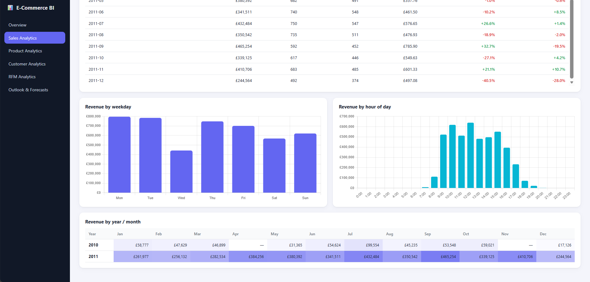
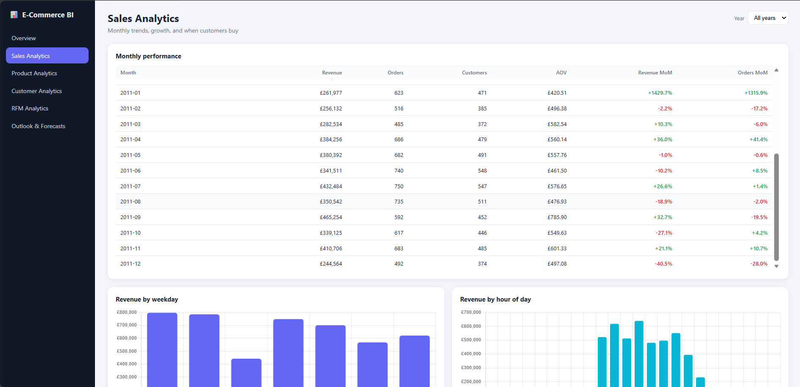
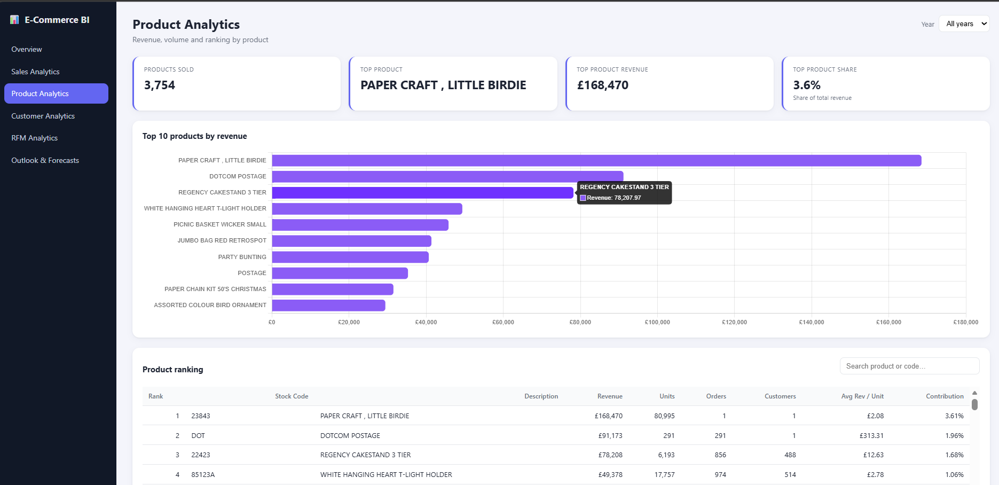
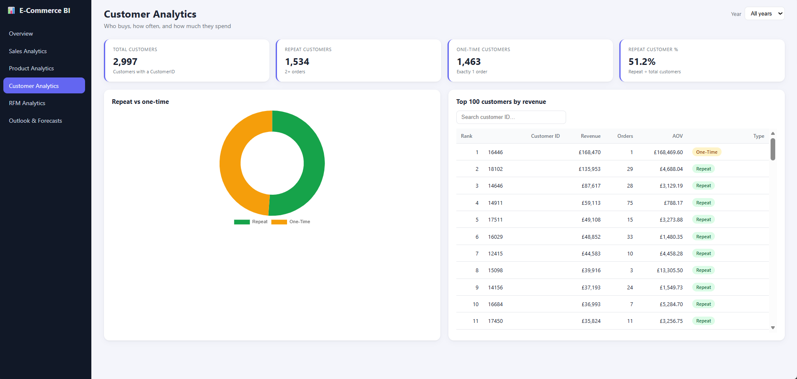
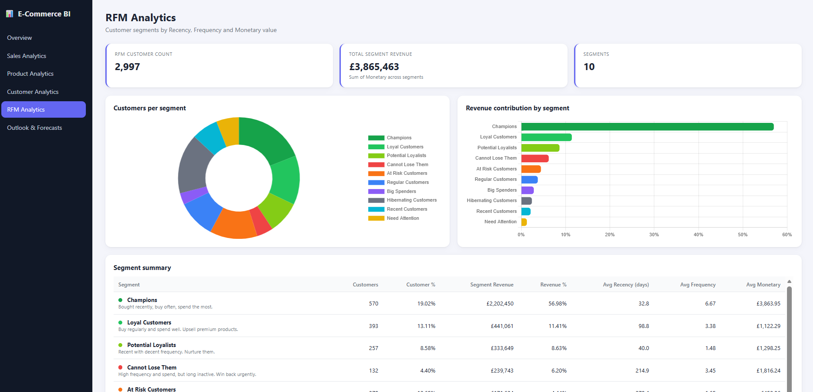
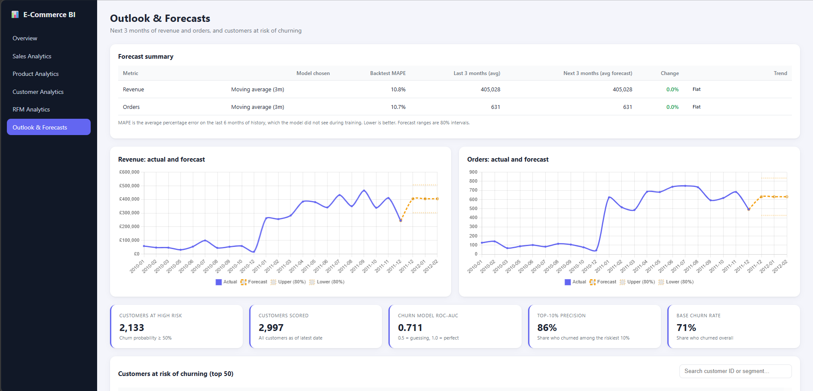
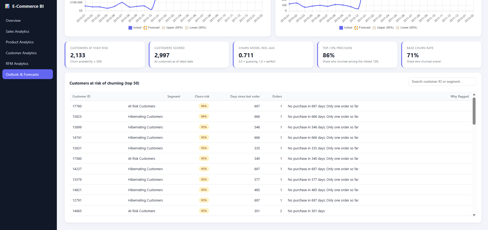

# E-Commerce Business Intelligence & Customer Analytics

An end-to-end analytics project built on the Online Retail transaction dataset. It covers data cleaning, exploratory analysis, SQL business reporting, RFM customer segmentation, machine-learning forecasting and churn prediction, and a Flask dashboard that brings the results together.

## Table of contents

- [Highlights](#highlights)
- [Project at a glance](#project-at-a-glance)
- [Getting started](#getting-started)
- [Project structure](#project-structure)
- [Phase 1: Data Acquisition](#phase-1-data-acquisition)
- [Phase 2: Data Cleaning & Data Quality](#phase-2-data-cleaning--data-quality)
- [Phase 3: Exploratory Data Analysis](#phase-3-exploratory-data-analysis)
- [Phase 4: SQL Business Analytics](#phase-4-sql-business-analytics)
- [Phase 5: RFM Customer Segmentation](#phase-5-rfm-customer-segmentation)
- [Phase 6: Machine Learning](#phase-6-machine-learning-forecasting--churn-prediction)
- [Phase 7: Website (Flask Dashboard)](#phase-7-website-flask-dashboard)
- [Running the full project](#running-the-full-project-in-order)
- [Known issues and limitations](#known-issues-and-limitations)
- [Technology stack](#technology-stack)

---

## Highlights

- Cleaned **225,423** sales records and identified **2,997** customers with a customer ID.
- Segmented customers into **10 RFM segments**. Champions are 19% of customers and generate 57% of identified-customer revenue.
- Built a **churn model** (ROC-AUC 0.71) whose top 10% of riskiest customers churned at 86%, against a 71% base rate.
- Built **forecasts** for monthly revenue and orders, with backtest error (MAPE) and 80% prediction ranges.
- Delivered a **seven-page Flask dashboard** covering KPIs, sales, products, customers, RFM and forecasts.

## Project at a glance

| Phase | Name | Status | Main output |
|-------|------|--------|-------------|
| 1 | Data Acquisition | Completed | Raw transaction dataset |
| 2 | Data Cleaning & Data Quality | Completed | Cleaned sales data, quality reports |
| 3 | Exploratory Data Analysis (EDA) | Completed (verify output files) | EDA tables, charts, insights |
| 4 | SQL Business Analytics | Completed | SQLite database, SQL scripts, CSV exports |
| 5 | RFM Customer Segmentation | Completed | Customer segments and RFM reports |
| 6 | Machine Learning: Forecasting & Churn | Completed | Forecasts, churn risk scores, saved model |
| 7 | Website (Flask dashboard) | Completed | Interactive analytics dashboard |

---

## Getting started

### Prerequisites

- Python 3.10 or newer
- Git
- The Online Retail dataset (see Phase 1)

### 1. Clone the repository

```powershell
git clone https://github.com/PravinPatil07/E-Commerce-Business-Intelligence-Customer-Analytics.git
cd E-Commerce-Business-Intelligence-Customer-Analytics
```

### 2. Add the dataset

Raw data and the SQLite database are not stored in the repository because of their size. Download the Online Retail dataset (UCI or Kaggle) and save it as:

```
data/raw/data.csv
```

### 3. Build the data, database and reports

Run these from the project root, in order:

```powershell
python data_pre_processing.py      # Phase 2: cleaning, writes data/processed/
python sql_setup.py                # Phase 4: builds database/ecommerce_analytics.db
python "RFM Customer Segmentation.py"   # Phase 5: writes reports/rfm_analysis/
```

`Exploratory Data Analysis.py` produces the Phase 3 tables and charts.

### 4. Train the ML models and run the dashboard

```powershell
cd Website
pip install -r requirements.txt
python -m ml.train_all             # Phase 6: forecasts and churn scores
python app.py                      # Phase 7: dashboard
```

Open **http://127.0.0.1:5000** in your browser.

---

## Project structure

```
E-Commerce-Business-Intelligence-Customer-Analytics/
├── data/
│   ├── raw/                          raw Online Retail data (not in repo)
│   └── processed/                    cleaned datasets (Phase 2)
├── database/
│   └── ecommerce_analytics.db        SQLite database (Phase 4, not in repo)
├── sql/                              SQL business analysis scripts (Phase 4)
├── reports/
│   ├── data_quality_report.csv       (Phase 2)
│   ├── phase2_summary.json
│   ├── eda_tables/                   (Phase 3)
│   ├── phase3_eda_summary.json
│   ├── phase3_business_insights.txt
│   ├── sql_results/                  (Phase 4)
│   ├── rfm_analysis/                 (Phase 5)
│   └── ml/                           (Phase 6 outputs)
├── models/
│   └── churn_model.joblib            (Phase 6)
├── visualizations/
│   └── phase3/                       (Phase 3 charts)
├── docs/
│   └── screenshots/                  (dashboard screenshots shown below)
├── data_pre_processing.py            Phase 2 cleaning script
├── Exploratory Data Analysis.py      Phase 3 EDA script
├── sql_setup.py                      Phase 4 database builder
├── RFM Customer Segmentation.py      Phase 5 RFM script
├── README.md
└── Website/                          Phase 6 and 7 application
    ├── ml/                           forecasting and churn code (Phase 6)
    │   ├── __init__.py
    │   ├── features.py
    │   ├── forecast.py
    │   ├── churn.py
    │   └── train_all.py
    ├── static/
    │   ├── css/style.css
    │   └── js/main.js
    ├── templates/
    │   ├── base.html
    │   ├── macros.html
    │   ├── overview.html
    │   ├── sales.html
    │   ├── products.html
    │   ├── customers.html
    │   ├── rfm.html
    │   └── outlook.html
    ├── analytics.py                  KPI calculations
    ├── app.py                        Flask routes
    ├── config.py                     paths and settings
    ├── README.md
    └── requirements.txt
```

---

## Phase 1: Data Acquisition

**Objective:** Collect the raw e-commerce transaction dataset used throughout the project.

**Dataset:** Online Retail transaction dataset (UCI / Kaggle). Retail transaction records from the e-commerce domain.

**Tools:** Python, pandas, CSV files, VS Code / Jupyter.

**Columns:**

| Column | Description |
|--------|-------------|
| InvoiceNo | Transaction / invoice identifier |
| StockCode | Product identifier |
| Description | Product description |
| Quantity | Quantity purchased |
| InvoiceDate | Transaction date and time |
| UnitPrice | Price per unit |
| CustomerID | Customer identifier |
| Country | Customer's country |

**Outcome:** Raw transactional data was acquired and prepared as the source for cleaning, analysis, SQL queries and customer analytics.

---

## Phase 2: Data Cleaning & Data Quality

**Objective:** Turn raw transactions into a reliable dataset for business analysis.

**Cleaning steps:**

- Checked for missing values and handled duplicate records.
- Removed invalid transactions, including those with non-positive quantity or unit price.
- Excluded cancellation transactions from the cleaned sales dataset.
- Validated invoice, product and date fields.
- Identified records without a customer ID and separated customer-identifiable transactions for customer analytics.

**Engineered features:**

| Feature | Purpose |
|---------|---------|
| Revenue | Quantity × Unit Price |
| InvoiceYear, InvoiceMonth, InvoiceYearMonth | Time-based grouping |
| InvoiceQuarter | Quarterly analysis |
| InvoiceDay, InvoiceDayOfWeek, InvoiceDayName | Day-level and weekday analysis |
| InvoiceHour | Hourly sales analysis |
| IsWeekend | Weekend vs weekday analysis |

**Processed datasets:**

| Dataset | Rows |
|---------|------|
| Cleaned sales (`cleaned_sales.csv`) | 225,423 |
| Customer-eligible sales (`customer_eligible_sales.csv`) | 166,363 |
| Cancellation records (`cancelled_transactions.csv`) | 9,251 |

**Quality reports:** `data_quality_report.csv`, `missing_values_report.csv`, `duplicate_report.csv`, `invalid_records_report.csv`, `outlier_report.csv`, `phase2_summary.json`.

---

## Phase 3: Exploratory Data Analysis

**Objective:** Understand sales patterns, customer behaviour, product performance, geographic spread and business trends.

**Analysis areas:**

1. **Sales performance:** revenue distribution, order volume, units sold, average order value.
2. **Time series:** monthly revenue and order trends, seasonal patterns, sales by weekday and hour.
3. **Products:** top products by revenue and quantity, demand and contribution.
4. **Customers:** purchasing behaviour, purchase frequency, repeat customers, revenue distribution.
5. **Geography:** revenue and orders by country.
6. **Revenue concentration:** revenue from top customers and top products.

**Outputs:**

| Output | Location |
|--------|----------|
| EDA summary | `reports/phase3_eda_summary.json` |
| Business insights | `reports/phase3_business_insights.txt` |
| Analytical tables | `reports/eda_tables/` |
| Charts | `visualizations/phase3/` |

**Note:** An earlier run failed with a `display()` error outside a notebook environment. Check that all EDA tables and charts exist before relying on them.

---

## Phase 4: SQL Business Analytics

**Objective:** Answer business questions with SQL, calculate KPIs, analyse trends, and produce exportable datasets.

**Technology:** SQLite, SQL, VS Code SQLite extension, Python, CSV exports.

**Database:** `database/ecommerce_analytics.db`, built by `sql_setup.py`.

| Table | Purpose |
|-------|---------|
| sales | Main sales transactions |
| customer_sales | Customer-identifiable sales records |
| cancellations | Cancelled transactions |

**Views:** `order_summary`, `customer_summary`

**SQL scripts (`sql/`):**

| Script | Analysis |
|--------|----------|
| 01_data_validation.sql | Database and data validation |
| 02_sales_kpi_analysis.sql | Sales KPIs |
| 03_time_series_analysis.sql | Monthly and time-based analysis |
| 04_product_analysis.sql | Product performance |
| 05_customer_analysis.sql | Customer analytics |
| 06_geographic_analysis.sql | Country and market analysis |
| 07_customer_retention_analysis.sql | Retention and repeat behaviour |

**Business questions answered:**

- **Sales:** total revenue, number of orders, average order value, units sold.
- **Time:** monthly revenue changes, strongest months, order activity over time.
- **Products:** highest-revenue products, best sellers by units.
- **Customers:** highest-revenue customers, purchase frequency, contribution to sales.
- **Geography:** countries with the most revenue and orders.
- **Retention:** repeat purchasers, purchase frequency, revenue distribution.

**CSV exports:**

| Export | Contents |
|--------|----------|
| monthly_sales_trends.csv | Monthly revenue, orders, customers, units, AOV |
| country_performance.csv | Revenue and performance by country |
| top_products_by_revenue.csv | Products ranked by revenue |
| top_customers_by_revenue.csv | Customers ranked by revenue |
| customer_cohort_assignment.csv | Customer cohort assignment |
| database_table_counts.csv | Record counts per table |

**SQL skills demonstrated:** SELECT, WHERE, GROUP BY, ORDER BY, SUM, COUNT, AVG, COUNT(DISTINCT), CTEs (WITH), CASE expressions, `strftime()` date functions, window functions, ranking.

---

## Phase 5: RFM Customer Segmentation

**Objective:** Segment customers by purchasing behaviour to identify valuable, loyal, new and at-risk customers.

**RFM definitions:**

| Metric | Meaning | Better value |
|--------|---------|--------------|
| Recency (R) | Days since the customer's last purchase | Lower |
| Frequency (F) | Number of orders in the analysis period | Higher |
| Monetary (M) | Total revenue from the customer | Higher |

**Scoring:** Customers were scored with quintile-based R, F and M scores, then assigned to behavioural segments.

**Segments and recommended actions:**

| Segment | Interpretation | Suggested action |
|---------|----------------|------------------|
| Champions | Best customers: recent, frequent, high spend | Rewards, loyalty benefits, early access |
| Loyal Customers | Repeat purchasers | Keep them engaged |
| Potential Loyalists | Showing signs of becoming loyal | Incentives for repeat purchases |
| Recent Customers | Purchased recently | Encourage the next purchase |
| At Risk Customers | No recent purchase | Re-engagement campaigns |
| Cannot Lose Them | Previously valuable, now inactive | Personalised retention |
| Hibernating Customers | Low or stale activity | Reactivation campaigns |
| Big Spenders | High monetary value | Premium offers, personalised recommendations |
| Need Attention | Need more engagement | Targeted promotions or follow-up |
| Regular Customers | Consistent, moderate activity | Maintain satisfaction and repeat purchases |

**Segment results (2,997 identified customers):**

| Segment | Customers | Customer % | Segment revenue | Revenue % |
|---------|-----------|------------|-----------------|-----------|
| Champions | 570 | 19.02% | £2,202,450 | 56.98% |
| Loyal Customers | 393 | 13.11% | £441,061 | 11.41% |
| Potential Loyalists | 257 | 8.58% | £333,649 | 8.63% |
| Cannot Lose Them | 132 | 4.40% | £239,743 | 6.20% |
| At Risk Customers | 379 | 12.65% | £171,634 | 4.44% |
| Regular Customers | 304 | 10.14% | £144,214 | 3.73% |
| Big Spenders | 92 | 3.07% | £109,404 | 2.83% |

**Outputs (`reports/rfm_analysis/`):** `customer_rfm.csv`, `rfm_segment_summary.csv`, `rfm_segment_distribution.csv`, `rfm_scores_distribution.png`, `rfm_segment_revenue.png`, `rfm_segment_customers.png`, `rfm_business_report.txt`.

---

## Phase 6: Machine Learning (Forecasting & Churn Prediction)

**Objective:** Estimate what happens next, not only what happened. Two models were built: a monthly forecast for revenue and orders, and a churn model that flags customers likely to stop buying.

**Code:** the `ml/` package inside `Website/`.

| File | Role |
|------|------|
| `ml/features.py` | Builds the monthly series and customer-level features, with churn labels |
| `ml/forecast.py` | Backtests and fits forecasting models, produces 80% ranges |
| `ml/churn.py` | Trains and evaluates the churn model, scores customers with reasons |
| `ml/train_all.py` | Entry point that runs everything and writes the outputs |

### 6.1 Forecasting (revenue and orders)

- Monthly series built from the sales data. The final month is dropped if it is incomplete.
- Candidate models: 3-month moving average, seasonal naive (same month last year), and Holt-Winters damped exponential smoothing (requires `statsmodels`).
- Each model is backtested on the last 6 months, which the model does not see during training. The model with the lowest MAPE is refit on the full history.
- Output: a 3-month forecast with an 80% range, a trend label (Growing, Flat or Declining, using a ±5% threshold), and the backtest table.

**Result from the most recent run:**

| Metric | Model chosen | Backtest MAPE | Last 3 months (avg) | Next 3 months (avg forecast) | Trend |
|--------|--------------|---------------|---------------------|------------------------------|-------|
| Revenue | Moving average (3m) | 10.8% | £405,028 | £405,028 | Flat |
| Orders | Moving average (3m) | 10.7% | 631 | 631 | Flat |

The moving average projects a flat line, so it shows no trend. It was chosen because it had the lowest backtest error among the models that ran. Check `reports/ml/forecast_backtest.csv` to see whether Holt-Winters ran; it needs `statsmodels` installed.

### 6.2 Churn prediction

- **Definition:** a customer is "churned" if they make no purchase in the 90 days after a cutoff date.
- **Features:** recency, tenure, frequency, monetary value, average order value, unique products, average days between orders, spend in the last 90 days, spend in the prior 90 days, and spend change.
- **Training:** many monthly cutoff dates. The most recent cutoff is held out for evaluation, so the model is always tested on data later than its training data.
- **Model:** scikit-learn `HistGradientBoostingClassifier`.
- **Scoring:** every customer is scored as of the latest date in the data, with a churn probability and plain-English reasons (for example, "No purchase in 147 days" or "Spend down 67% vs prior 90 days").

**Result from the most recent run:**

| Metric | Value | Meaning |
|--------|-------|---------|
| Base churn rate | 71% | Share of customers who did not buy in the next 90 days |
| ROC-AUC | 0.711 | Better than chance, but only moderate separation |
| Precision in top 10% | 86% | Churn rate among the riskiest 10%, compared with 71% overall |
| Customers at high risk (≥ 50%) | 2,133 of 2,997 | Customers with churn probability of at least 50% |

Use the ranking to prioritise outreach, and review the reasons before acting on any individual customer.

### 6.3 Outputs

| File | Contents |
|------|----------|
| `reports/ml/forecast_monthly.csv` | 3-month forecasts, lower and upper bounds for revenue and orders |
| `reports/ml/forecast_summary.csv` | Chosen model, backtest error, trend per metric |
| `reports/ml/forecast_backtest.csv` | Error for every candidate model |
| `reports/ml/churn_risk.csv` | Churn probability and reasons for every customer, with RFM segment |
| `reports/ml/churn_metrics.csv` | Churn model evaluation |
| `models/churn_model.joblib` | Saved churn model and feature list |

---

## Phase 7: Website (Flask Dashboard)

**Objective:** Present the analysis, RFM segments and ML outputs in an interactive dashboard that business users can browse without running any code.

**Technology:** Flask, pandas, Jinja2 templates, Chart.js, plain CSS and JavaScript.

### 7.1 Pages

| Page | URL | Contents |
|------|-----|----------|
| Overview | `/` | Eight headline KPIs, monthly revenue and orders chart, top 5 products and customers |
| Sales Analytics | `/sales` | Monthly table with MoM growth, revenue by weekday and hour, year × month heatmap |
| Product Analytics | `/products` | Product revenue, units, orders, customers, revenue per unit, ranking, contribution |
| Customer Analytics | `/customers` | Total, repeat and one-time customers, repeat %; top-100 customers table |
| RFM Analytics | `/rfm` | Customers per segment, segment revenue and contribution, average R, F and M |
| Outlook & Forecasts | `/outlook` | Forecast summary, revenue and orders charts with 80% range, churn metrics, top-50 at-risk customers |
| API | `/api/kpis` | Overview KPIs as JSON |

### 7.2 KPI definitions

| KPI | Calculation |
|-----|-------------|
| Total Revenue | Sum of Revenue |
| Total Orders | Unique InvoiceNo |
| Total Customers | Unique non-null CustomerID |
| Average Order Value | Revenue ÷ orders |
| Total Units Sold | Sum of Quantity |
| Revenue per Customer | Revenue ÷ customers |
| Average Selling Price | Revenue ÷ quantity |
| Orders per Customer | Orders ÷ customers |

**Current values (all years):** Total revenue £4,663,256 · Orders 8,556 · Customers 2,997 · AOV £545.03 · Units sold 2,388,383 · Revenue per customer £1,555.97 · Average selling price £1.95 · Orders per customer 2.85.

### 7.3 Dashboard screenshots

**Overview.** Headline KPIs, monthly revenue and orders, and the top products and customers.



**Sales Analytics.** Monthly performance with month-over-month growth, plus revenue by weekday and by hour.



**Product Analytics.** Product KPIs, the top 10 products by revenue, and the searchable product ranking.



**Customer Analytics.** Repeat vs one-time customers (1,534 repeat, 1,463 one-time, 51.2% repeat rate), with the top 100 customers by revenue.



**RFM Analytics.** Customer count per segment, revenue contribution by segment, and the segment summary table.



**Outlook & Forecasts.** Forecast summary, revenue and orders charts with 80% ranges, and churn model metrics.



**Outlook: customers at risk of churning.** The top 50 customers by churn probability, with the reasons each was flagged.



### 7.4 Features

- Sidebar navigation with the active page highlighted.
- Year filter in the top bar, applied to Overview, Sales, Products and Customers. RFM and Outlook use snapshot data and have no year filter.
- Sortable tables: click a column header. Currency columns sort numerically.
- Live search on the product, customer and risk tables.
- Responsive layout for smaller screens.

### 7.5 Code structure

| File | Role |
|------|------|
| `app.py` | Routes, Jinja filters (money, number, percent), year filter |
| `analytics.py` | All KPI calculations with pandas, loads the SQLite sales table |
| `config.py` | Paths and settings (overridable with environment variables) |
| `templates/` | `base.html` (layout), `macros.html` (KPI card), one template per page |
| `static/css/style.css` | Styling |
| `static/js/main.js` | Table search, sorting, currency formatter |

### 7.6 Configuration

Paths default to the folder layout above. Override them with environment variables if your files are elsewhere.

| Variable | Default |
|----------|---------|
| `ECOM_DB_PATH` | `database/ecommerce_analytics.db` |
| `ECOM_SALES_TABLE` | `sales` |
| `ECOM_RFM_PATH` | `reports/rfm_analysis/customer_rfm.csv` |
| `ECOM_ML_DIR` | `reports/ml` |
| `ECOM_MODEL_DIR` | `models` |
| `ECOM_CURRENCY` | `£` |
| `SECRET_KEY` | `dev-change-me` (set a real value before deploying) |

---

## Running the full project in order

1. **Phases 1–2:** place the dataset at `data/raw/data.csv`, then run `python data_pre_processing.py`.
2. **Phase 3:** run `Exploratory Data Analysis.py` and check the outputs in `reports/eda_tables/` and `visualizations/phase3/`.
3. **Phase 4:** run `python sql_setup.py` to build `database/ecommerce_analytics.db`, then run the scripts in `sql/` as needed.
4. **Phase 5:** run `python "RFM Customer Segmentation.py"` to produce `reports/rfm_analysis/`.
5. **Phase 6:** from `Website/`, run `python -m ml.train_all`.
6. **Phase 7:** from `Website/`, run `python app.py` and open http://127.0.0.1:5000.

Run step 5 again whenever the sales data changes.

---

## Known issues and limitations

- **Missing months in monthly charts.** The Overview and Outlook charts skip some months (for example, 2010-04 and 2010-11 do not appear). The monthly series used for forecasting fills missing months with zero, so those gaps count as zero-revenue months in the model. This can distort the forecast and the backtest error.
- **Partial final month.** The forecasting code drops an incomplete final month from history, but the Outlook chart still shows December 2011 as an actual value, and the forecast starts from that month. The two views should use the same month definition.
- **Revenue concentration from single large orders.** The top product (PAPER CRAFT, LITTLE BIRDIE, £168,470) and the top customer (16446, £168,470, one order) are driven by one very large order. Revenue rankings are sensitive to these outliers.
- **Totals differ between pages.** Overview revenue (£4,663,256) includes all sales rows. RFM segment revenue (£3,865,463) covers only identified customers, so the two totals are not expected to match.
- **Churn flags many one-time buyers.** The top at-risk list is dominated by customers with a single order and no purchase in 300+ days. The model is most useful for repeat customers, so consider scoring one-time buyers separately.
- **Short history.** About two years of data limits seasonal modelling. Forecasts are directional.
- **Forecast outcome.** The selected model is a moving average that projects a flat trend. Treat it as a baseline until Holt-Winters has been evaluated.
- **Churn accuracy.** A ROC-AUC of 0.71 is useful for prioritisation but not for certain predictions. A customer who has stopped buying may simply be seasonal, so review before acting.

---

## Technology stack

Python, pandas, NumPy, SQLite, SQL, scikit-learn, statsmodels, joblib, Flask, Jinja2, Chart.js, HTML, CSS, JavaScript, VS Code, Jupyter.
